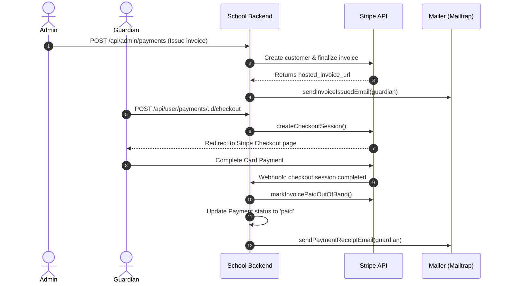

# School Management System

A comprehensive school management backend API built with Node.js, Express, and MongoDB, featuring multi-role access (Admin, Teacher, Student, Guardian), Stripe payment integration, automated email notifications via Mailtrap, and media management via Cloudinary.

---

## Features

### Core & Cross-Cutting
- **Role-Based Access Control (RBAC)** - Tailored middlewares and permissions for Admin, Teacher, Student, and Guardian roles.
- **Secure Authentication** - JWT-based authentication with bcrypt password hashing and secure token validation.
- **Stripe Payment Engine** - Invoicing, Stripe Checkout sessions, out-of-band payment settlement, and automated webhook synchronization.
- **Email Notification System** - Mailtrap HTTP integration with responsive HTML templates for account credentials, invoices, and payment receipts.
- **Media & Document Storage** - Multer and Cloudinary integration with automatic image and document upload handling.
- **Dynamic Access Control** - Specialized scope and access helpers for exams, attendance, lessons, and homework.

### Admin Features
- **Admin Dashboard** - Real-time statistics, payment KPIs, and system overview.
- **Student Management** - Student registration with ID documents, guardian associations, class assignments, and status toggles.
- **Teacher Management** - Onboarding with credentials generation, automated welcome email, class linking, and status management.
- **Guardian Management** - Guardian profile tracking, linked student lookups, and account status management.
- **Payment & Invoice Management** - Issue fees/invoices, synchronize with Stripe, cancel/resend invoices, and track overdue balances.
- **Class Management** - Create, read, and update classes with course linking and cover images.
- **Course Management** - Manage courses with teacher assignments and class associations.
- **Complaint Management** - View grievances and complaints with reporter hydration.
- **Announcement Management** - Create, update, and manage school announcements.

### Teacher Features
- **Lesson Management** - Create and update lessons with learning objectives, materials, and attachments.
- **Homework Management** - Assign homework with due dates, descriptions, and file uploads.
- **Exam & Result Management** - Schedule exams and submit/update student scores and grading in bulk.
- **Attendance Tracking** - Record, update, and review student attendance per lesson.
- **Classes & Guardians Directory** - View assigned classes, enrolled students, and linked guardian contact info.

### User Portal (Student & Guardian)
- **Announcements Feed** - Browse school announcements with detailed view.
- **Lessons & Homework** - Access published course lessons and assigned homework tasks.
- **Exam Schedules & Results** - View upcoming exams and student performance summaries.
- **Attendance History** - View student attendance metrics, daily records, and ward attendance (for guardians).
- **Payment Portal** - View pending fees, review payment history, download receipts, and pay online via Stripe Checkout.
- **Unified Dashboard** - Aggregated user overview of upcoming classes, pending tasks, and recent grades.

---

## Getting Started

### Prerequisites
- **Node.js** (v18+)
- **MongoDB** instance (local or Atlas)
- **Cloudinary** account (for media uploads)
- **Stripe** account (for payments & webhooks)
- **Mailtrap** account (for transactional emails)

### Installation
```bash
git clone https://github.com/FarhadNuri/School-Management.git
cd School-Management
npm install
```

### Environment Variables
Create a `.env` file in the root directory:
```env
PORT=5000
NODE_ENV=development

# Database
MONGO_URI=your_mongodb_connection_string

# Authentication
JWT_SECRET=your_jwt_secret_key
JWT_EXPIRES_IN=7d

# Application URLs
FRONTEND_URL=http://localhost:5173
ADMIN_URL=http://localhost:5174

# Cloudinary
CLOUDINARY_CLOUD_NAME=your_cloudinary_name
CLOUDINARY_API_KEY=your_cloudinary_api_key
CLOUDINARY_API_SECRET=your_cloudinary_api_secret

# Mailtrap Transactional Email
MAILTRAP_TOKEN=your_mailtrap_api_token
MAILTRAP_FROM_EMAIL=your_verified_sender@domain.com
MAILTRAP_FROM_NAME="School Web App"

# Stripe Payments
STRIPE_API_KEY=your_stripe_secret_key
STRIPE_PUBLISHABLE_KEY=your_stripe_publishable_key
STRIPE_WEBHOOK_SECRET=your_stripe_webhook_signing_secret
```

### Running Locally
```bash
# Start development server with file watching
npm run dev
```

---

## Project Structure

```
src/
├── config/
│   ├── cloudinary.js       # Cloudinary media configuration
│   ├── env.js              # Environment variable loader & named exports
│   ├── seedAdmin.js        # Default admin initializer
│   └── stripe.js           # Stripe SDK client initialization
├── controllers/
│   ├── admin/              # Admin domain controllers
│   │   ├── admin.controller.js
│   │   ├── announcement.controller.js
│   │   ├── class.controller.js
│   │   ├── complaint.controller.js
│   │   ├── course.controller.js
│   │   ├── dashboard.controller.js
│   │   ├── guardian.controller.js
│   │   ├── payment.controller.js
│   │   ├── student.controller.js
│   │   └── teacher.controller.js
│   ├── teacher/            # Teacher domain controllers
│   │   ├── attendance.controller.js
│   │   ├── exam.controller.js
│   │   ├── homework.controller.js
│   │   ├── lesson.controller.js
│   │   └── teacher.controller.js
│   ├── user/               # Student & Guardian domain controllers
│   │   ├── announcement.controller.js
│   │   ├── attendance.controller.js
│   │   ├── dashboard.controller.js
│   │   ├── exam.controller.js
│   │   ├── homework.controller.js
│   │   ├── lesson.controller.js
│   │   ├── payment.controller.js
│   │   ├── student.controller.js
│   │   └── user.controller.js
│   └── user.controller.js  # Base user profile & auth
├── middleware/
│   ├── admin.middleware.js   # Admin JWT & RBAC guard
│   ├── teacher.middleware.js # Teacher authentication guard
│   ├── user.middleware.js    # Student/Guardian authentication guard
│   └── multer.middleware.js  # Upload parser (avatars, lessons, IDs)
├── models/
│   ├── admin.model.js
│   ├── announcement.model.js
│   ├── assignment.model.js
│   ├── attendance.model.js
│   ├── class.model.js
│   ├── complaint.model.js
│   ├── course.model.js
│   ├── event.model.js
│   ├── exam.model.js
│   ├── guardian.model.js
│   ├── homework.model.js
│   ├── lesson.model.js
│   ├── notification.model.js
│   ├── payment.model.js
│   ├── quiz.model.js
│   ├── resource.model.js
│   ├── student.model.js
│   ├── teacher.model.js
│   └── user.model.js
├── routes/
│   ├── admin.route.js       # /api/admin
│   ├── teacher.route.js     # /api/teacher
│   └── user.route.js        # /api/user
├── services/
│   └── stripe.service.js    # Stripe invoices, checkout & sync operations
├── utils/
│   ├── attendanceAccess.js  # Attendance calculation & ward lookup
│   ├── emailTemplate.js     # Responsive HTML email templates
│   ├── examAccess.js        # Exam scoping, roster filtering & stats
│   ├── generatePassword.js  # Secure random password generator
│   ├── homeworkAccess.js    # Homework submission & scope validation
│   ├── idTypes.js           # Identification type validation & normalization
│   ├── lessonAccess.js      # Lesson authorization & scope filtering
│   ├── Mailer.js            # Mailtrap HTTP email transport service
│   ├── payment.helpers.js   # Fee labels, serialization, and population
│   ├── paymentEmails.js     # Payment receipt & invoice email dispatcher
│   └── userHelpers.js       # Address normalization, search & data sanitation
├── webhooks/
│   ├── index.js             # Webhook route definitions
│   └── stripe.webhook.js    # Stripe event signature validation & handlers
└── index.js                 # Application bootstrap & database connection
```

---

## API Routes Overview

### Admin Routes (`/api/admin`)
| Method | Endpoint | Description |
| :--- | :--- | :--- |
| **POST** | `/login` | Admin authentication |
| **GET** | `/me` | Current admin profile |
| **PATCH** | `/change-password` | Update admin password |
| **PATCH** | `/update-photo` | Update profile picture |
| **GET** | `/dashboard` | System statistics and analytics |
| **POST** / **GET** | `/announcements` | Create or list announcements |
| **POST** / **GET** | `/classes` | Create or list classes with cover images |
| **POST** / **GET** | `/courses` | Create or list courses with teacher links |
| **GET** | `/complaints` | Review student & teacher complaints |
| **POST** / **GET** | `/students` | Register student or browse roster |
| **PATCH** | `/students/:id` | Update student or status |
| **GET** | `/guardians` | List parent/guardian accounts |
| **POST** / **GET** | `/teachers` | Onboard teacher or list faculty |
| **POST** / **GET** | `/payments` | Issue invoices or list all school fees |
| **POST** | `/payments/:id/resend` | Resend invoice notification email |
| **POST** | `/payments/:id/cancel` | Void invoice in Stripe and locally |

### Teacher Routes (`/api/teacher`)
| Method | Endpoint | Description |
| :--- | :--- | :--- |
| **GET** | `/classes` | List teacher's assigned classes |
| **GET** | `/guardians` | View guardians of students in teacher's classes |
| **GET** / **POST** | `/lessons` | List or create lessons with attachments |
| **PATCH** | `/lessons/:id` | Update lesson content or files |
| **GET** / **POST** | `/homeworks` | List or assign homework tasks |
| **GET** / **POST** | `/exams` | List or schedule exams |
| **PUT** | `/exams/:id/results` | Submit or update exam grades & marks |
| **GET** | `/attendance/lessons` | List lessons scheduled for attendance |
| **GET** / **PUT** | `/attendance/lessons/:lessonId` | Retrieve or record student attendance |

### User Routes (`/api/user` - Students & Guardians)
| Method | Endpoint | Description |
| :--- | :--- | :--- |
| **GET** | `/dashboard` | User dashboard overview |
| **GET** | `/announcements` | View published school announcements |
| **GET** | `/lessons` | View accessible class lessons |
| **GET** | `/homeworks` | View homework assignments |
| **GET** | `/exams` | View exam schedules and scores |
| **GET** | `/students` | View profile or linked wards (guardians) |
| **GET** | `/attendance` | View attendance record |
| **GET** | `/attendance/summary` | Aggregate attendance percentage & metrics |
| **GET** | `/attendance/wards` | View children attendance records (guardians) |
| **GET** | `/payments` | View fee history and pending balances |
| **POST** | `/payments/:id/checkout` | Create Stripe Checkout session for payment |
| **GET** | `/payments/checkout-session/:id` | Confirm completed Stripe Checkout session |

### Webhook Routes (`/api/webhooks`)
| Method | Endpoint | Description |
| :--- | :--- | :--- |
| **POST** | `/stripe` | Verifies Stripe signature and processes `checkout.session.completed` and `invoice.paid` |

---

## Email & Payment Lifecycles

### Automated Transactional Emails
All transactional emails are delivered via **Mailtrap** with branded, mobile-responsive HTML templates:
1. **Credentials Email**: Automatically triggered on Student, Teacher, or Guardian creation with generated temporary passwords.
2. **Invoice Issued Email**: Dispatched when an admin creates an invoice, including student details, due date, and direct pay link.
3. **Payment Receipt Email**: Automatically generated and sent upon Stripe checkout completion, webhook confirmation, or offline payment recording.

### Stripe Integration Workflow


---

## Contributing

1. Create a feature branch (`git checkout -b feature/feature-name`)
2. Commit your changes with conventional commit messages (`git commit -m "feat(...): ..."`)
3. Push to the branch (`git push origin feature/feature-name`)
4. Create a Pull Request with a clear summary of modifications

---

## License

This project is licensed under the MIT License.
